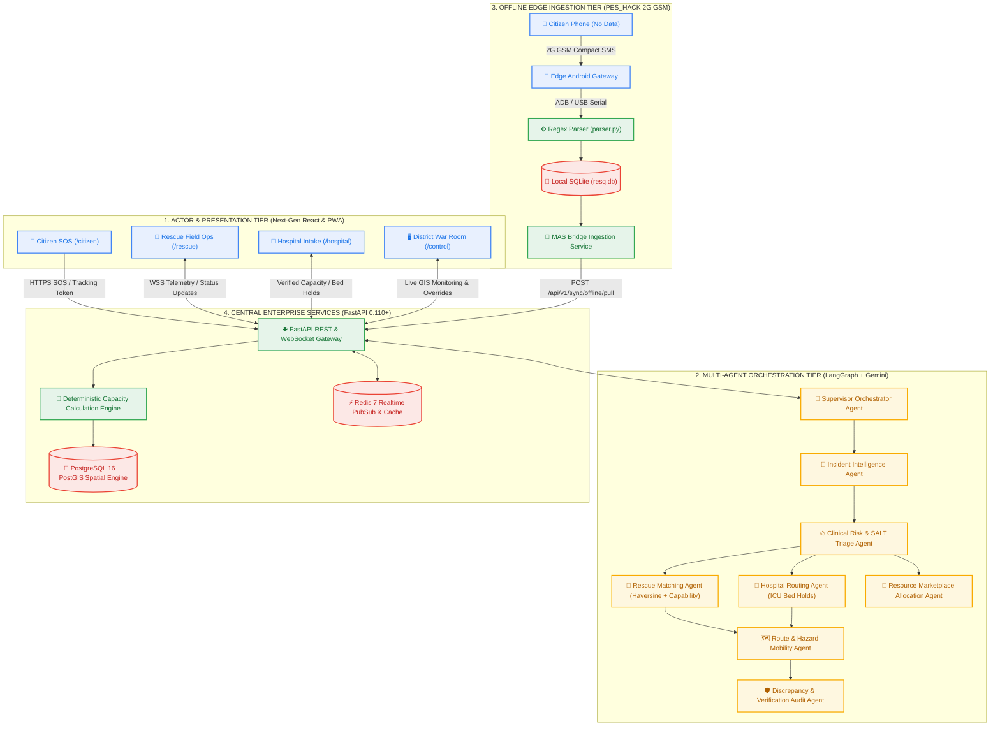

# RESQ — Agentic Disaster Coordination & Autonomous Multi-Agent Operating System

<div align="center">

[](https://resq-inky.vercel.app/)
[](https://fastapi.tiangolo.com/)
[](https://www.postgresql.org/)
[](https://github.com/langchain-ai/langgraph)
[](https://sqlite.org/)

**A distributed cognitive operating system coordinating Citizens, Autonomous Rescue Wings, Hospital ICU Triage, and State Command in real-time.**

[🌐 Explore Live Application](https://resq-inky.vercel.app/) • [📱 Citizen SOS](https://resq-inky.vercel.app/citizen) • [🚤 Rescue Ops](https://resq-inky.vercel.app/rescue) • [🏥 Hospital Intake](https://resq-inky.vercel.app/hospital) • [🖥️ War Room](https://resq-inky.vercel.app/control)

</div>

---

## ⚡ Live Deployment Showcase

The complete RESQ multi-portal ecosystem is live and globally distributed:

### 🔗 **Primary Web URL:** [`https://resq-inky.vercel.app/`](https://resq-inky.vercel.app/)

| Portal | Route | Primary Actor | Capabilities |
| :--- | :--- | :--- | :--- |
| **📱 Citizen Voice & Offline SOS** | [`/citizen`](https://resq-inky.vercel.app/citizen) | Trapped Citizens & Victims | Voice-first Malayalam/English emergency reporting, GPS bounding, and **zero-internet 2G GSM SMS fallbacks**. |
| **🚤 Rescue Field Ops** | [`/rescue`](https://resq-inky.vercel.app/rescue) | Nestwise NGO & NDRF Teams | Tactical GPS extraction missions, casualty tracking, proximity medical facility radar, and two-way safety confirmation. |
| **🏥 Hospital Intake & Triage** | [`/hospital`](https://resq-inky.vercel.app/hospital) | Triage Doctors & Superintendents | **Deterministic ICU capacity engine**, inbound casualty triage bays, and **30-minute atomic bed holds**. |
| **🖥️ District Control Room** | [`/control`](https://resq-inky.vercel.app/control) | State Emergency Directors (DEOC) | Real-time 14-district Kerala GIS map, live telemetry streams, resource tracking, and multi-agent supervisory controls. |
| **🔍 Token-Based Citizen Tracker** | `/track/:token` | Anonymous Citizen | Real-time live status tracking token (`UUIDv4`) allowing victims to monitor assigned rescue units without registration. |

---

## 🔑 Pre-Configured Demo Credentials

Use these verified emergency response credentials to test staff-gated portals on the live deployment:

| Portal Role | Email | Password | Access Scope |
| :--- | :--- | :--- | :--- |
| **State Emergency Director** | `superadmin@resq.gov.in` | `Admin@123456` | Full Control Room & Global Overrides |
| **DEOC Control Room Dispatcher** | `dispatcher@ernakulam.resq.gov.in` | `Dispatch@123` | Task Dispatching & Resource Management |
| **Hospital Superintendent** | `hospitaladmin@general.resq.gov.in` | `Hospital@123` | Hospital Bed Allocations & Bed Counts |
| **Triage Specialist Doctor** | `doctor@wayanad.resq.gov.in` | `Doctor@123` | Casualty Intake & Trauma Acceptance |
| **Field Rescue Responder** | `responder@nestwise.org` | `Rescue@123` | Field Ops Tactical Console & Telemetry |

---

## 1. What is RESQ?

During extreme disasters like the **2024 Wayanad Landslides** and **Kerala Floods**, passive dashboards and fragmented phone lines lead to fatal delays. 

**RESQ** is an autonomous multi-agent disaster coordination system. When an emergency incident occurs, RESQ treats it as a root coordinating entity and automatically decomposes it into synchronized response tasks:
1. **Physical Extraction:** Spatial discovery matching the nearest NDRF or verified humanitarian NGO boat team.
2. **Emergency Transit:** Route-cleared ALS Ambulance dispatch avoiding submerged bridges.
3. **Clinical Intake:** **Deterministic 30-minute atomic ICU bed reservation** at the nearest hospital.
4. **Supply Replenishment:** Real-time cross-match of O-negative blood units and relief inventory.

---

## 2. Multi-Agent System (MAS) Architecture



---

## 3. Mathematical Models & Deterministic Engines

RESQ strictly avoids LLM hallucinations for mission-critical calculations. Deterministic PostgreSQL constraints and spatial algorithms enforce life-safety rules:

### A. Deterministic Bed Availability Formula (ADR 002)
LLMs never compute or guess inventory numbers:
$$\text{Available Beds} = \text{Total} - \text{Occupied} - \text{Reserved} - \text{OutOfService}$$
* Enforced with **PostgreSQL CHECK constraints** and **30-minute atomic locks**.

### B. Haversine Spatial Proximity Formula
Calculates spherical distance between incident coordinates and rescue teams:
$$a = \sin^2\left(\frac{\Delta\text{lat}}{2}\right) + \cos(\text{lat}_1)\cos(\text{lat}_2)\sin^2\left(\frac{\Delta\text{lon}}{2}\right)$$
$$d = 2R \cdot \arctan2(\sqrt{a}, \sqrt{1-a}) \quad (R = 6371\text{ km})$$

### C. Rescue Team Ranking Scoring (0–100 Points)
$$\text{Total Score} = \text{Capability Score (0--50)} + \text{Proximity Score (0--50)}$$
* **Capability Match:** Ratio of required extraction equipment (`MOTORIZED_BOAT`, `DEBRIS_CLEARANCE`, `DIVERS`).
* **Proximity Score:** Step-wise rating based on transit distance ($<5\text{km} \rightarrow 50\text{ pts}$, $<15\text{km} \rightarrow 40\text{ pts}$).

---

## 4. Offline-to-Online Edge Architecture (PES_HACK)

When 4G/5G mobile towers fail in disaster epicenters, RESQ seamlessly transitions to **PES_HACK Offline Mode**:

1. **Compact SMS Encoding:** Citizen generates standard 2G SMS format:
   ```text
   FLOOD | TRAPPED | 11.56010,76.13350
   ```
2. **Edge Hardware Receiver:** Basecamp Android device / GSM modem captures raw SMS over ADB.
3. **Local SQLite Persistence:** `parser.py` validates Kerala GPS bounds and stores records into `resq.db`.
4. **Autonomous Ingestion Bridge:** When satellite, drone mesh, or temporary hotspot connects, `OfflineBridgeSyncService` transfers records to central PostgreSQL:
   ```python
   from backend.agent_tool_wrapper import query_offline_database_json

   # Autonomous AI agent queries field edge node directly
   field_reports = query_offline_database_json(hazard_type="FLOOD", urgency="CRITICAL")
   ```

---

## 5. Repository Structure

```text
RESQ/
├── frontend/                          # High-Performance TanStack Start SSR App
│   ├── src/routes/                    # File-based routes (/citizen, /rescue, /hospital, /control)
│   ├── src/lib/crisis-sync.ts         # Real-time cross-portal BroadcastChannel & event sync
│   └── src/lib/api.ts                 # Typed API client with auto-healing JWT session gate
│
├── backend/                           # Core FastAPI 0.110+ Enterprise Backend
│   ├── app/api/v1/                    # REST routes (auth, incidents, tasks, resources, sync)
│   ├── app/models/                    # SQLAlchemy 2.0 ORM models with PostGIS geometries
│   ├── app/services/                  # Deterministic capacity, dispatch, and hospital routing
│   ├── app/services/offline_bridge_sync.py # PES_HACK edge database ingestion bridge
│   └── agent_tool_wrapper.py          # Universal bridge tool for LangChain, CrewAI, Gemini
│
├── agents/                            # Multi-Agent Coordination System (LangGraph)
│   ├── orchestrator/                  # Supervisor agent coordinating multi-agent state graph
│   ├── incident_intelligence/         # NLP triage & structured entity extractor
│   ├── rescue_matching/               # Haversine spatial discovery for rescue wings
│   ├── hospital_matching/             # Clinical triage & 30-min atomic bed holds
│   └── agent_tool_wrapper.py          # Agent import bindings for offline edge queries
│
├── simulation/                        # Kerala Synthetic Disaster Scenarios
│   └── seed_data/                     # Seed scripts for hospitals, NGOs, and fleet
├── docker-compose.yml                 # PostgreSQL 16 PostGIS & Redis 7 services
└── Dockerfile                         # Production-grade non-root container configuration
```

---

## 6. Local Quickstart Guide

### 6.1 Clone & Environment Setup
```bash
git clone https://github.com/Pavan-Gowda-S/Resq.git
cd Resq
cp .env.example .env
```

### 6.2 Spin Up Infrastructure via Docker
```bash
docker compose up -d
```
*(Starts PostgreSQL 16 with PostGIS on `5432` and Redis 7 on `6379`)*

### 6.3 Run Backend API
```bash
python -m venv venv
.\venv\Scripts\Activate.ps1    # On Linux/macOS: source venv/bin/activate
pip install -r backend/requirements.txt
alembic -c backend/alembic.ini upgrade head
python -m uvicorn backend.app.main:app --host 0.0.0.0 --port 8000 --reload
```

### 6.4 Run Frontend Application
```bash
cd frontend
npm install
npm run dev
```
Open **`http://localhost:3000`** in your browser.

---

## 7. Security, Auditing & Governance

* **Zero-Knowledge Citizen Privacy:** Victims submit emergency reports anonymously; no credentials or phone verification required to initiate life-saving extraction.
* **Cryptographic Tracking Tokens:** UUIDv4 tokens ensure unauthenticated victims retain live access to response progress while preventing unauthorized tampering.
* **Immutable Audit Trail:** Every status change, task transition, and bed hold is recorded in an append-only audit ledger with actor UUIDs and millisecond timestamps.

---

<div align="center">
  <b>Built for Resilient Disaster Response · Kerala Relief & Rescue Coordination</b>
</div>
