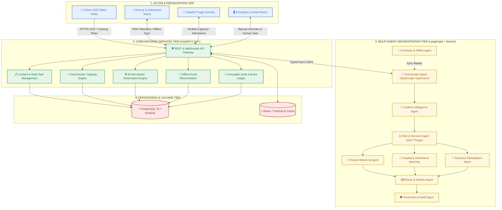

# RESQ — Agentic Emergency Response & Autonomous Resource Coordination Platform

[](https://www.python.org/)
[](https://fastapi.tiangolo.com/)
[](https://www.postgresql.org/)
[](https://github.com/langchain-ai/langgraph)
[]()

---

## 1. What is RESQ?

**RESQ** is an agentic emergency-response and autonomous resource-coordination platform. Unlike passive emergency dashboards, RESQ acts as a distributed cognitive operating system that coordinates citizens, rescue teams, emergency medical services, hospitals, blood banks, and relief suppliers in real-time.

### Core Architectural Principle
**One incident can require multiple linked response tasks.**
When an emergency occurs (such as an injured person trapped in a flooded building), RESQ automatically spins up linked tasks for:
1. Physical rescue extraction (Boat team).
2. Emergency transit (ALS Ambulance).
3. Healthcare intake (Hospital ICU bed reservation).
4. Supply replenishment (Blood units, medical kits).

---

## 2. System Architecture Diagram

> Full detailed architectural specifications, lifecycle state machines, and data flow sequences are available in [`docs/system-architecture/system-architecture-diagram.md`](docs/system-architecture/system-architecture-diagram.md).



---

## 3. Team Roles & Active Development

Development is split into two active disciplines:

| Role | Primary Working Directory | Owned Documents & Components |
| :--- | :--- | :--- |
| **Developer 1: Backend & Database** | `backend/` | PostgreSQL schema, PostGIS queries, FastAPI services, RBAC, deterministic capacity engine, offline sync APIs, `docs/api/api-contracts.md`. |
| **Developer 2: Integration & AI Agents** | `agents/` | LangGraph state graph, 9 specialized agents, Gemini API integration, triage heuristics, autonomous marketplace allocation, simulation scenarios. |
| **Frontend Portals** | `frontend/` | *Intentionally postponed. Development begins after core backend and agent validation passes.* |

---

## 3. Repository Directory Structure

```text
RESQ/
├── README.md                          # Master project documentation
├── .gitignore                         # Standard git ignore definitions
├── .env.example                       # Environment configuration template
├── docker-compose.yml                 # PostgreSQL 16 + PostGIS & Redis 7 services
│
├── docs/                              # Shared Project Knowledge Base
│   ├── system-architecture/           # High-level architecture, workflow, agent spec
│   │   ├── architecture.md
│   │   ├── system-workflow.md
│   │   └── agent-architecture.md
│   ├── database/                      # Schemas, constraints & ER diagram
│   │   ├── database-schema.md
│   │   └── er-diagram.md
│   ├── api/                           # Authoritative REST & WebSocket contracts
│   │   └── api-contracts.md
│   ├── locations/                     # Topography & Kerala disaster coordinates
│   │   ├── kerala-regions.md
│   │   └── map-data.md
│   └── team/                          # Governance, phase gates & progress
│       ├── responsibilities.md
│       ├── development-phases.md
│       ├── decisions.md
│       └── progress/
│           ├── backend-progress.md
│           └── integration-progress.md
│
├── backend/                           # Developer 1 Domain (FastAPI + SQLAlchemy)
│   ├── app/
│   │   ├── api/                       # API routes
│   │   ├── models/                    # Database ORM models
│   │   ├── schemas/                   # Pydantic schemas
│   │   ├── services/                  # Business logic & capacity calculations
│   │   ├── database/                  # Connection engine & session management
│   │   ├── auth/                      # JWT auth & RBAC permissions
│   │   ├── realtime/                  # WebSockets & Redis PubSub
│   │   └── main.py                    # Application entrypoint
│   ├── migrations/                    # Alembic migration revisions
│   ├── tests/                         # Backend automated test suite
│   └── requirements.txt               # Backend dependencies
│
├── agents/                            # Developer 2 Domain (LangGraph + Gemini)
│   ├── orchestrator/                  # Central supervisor agent
│   ├── incident_intelligence/         # Report parsing & entity extraction
│   ├── risk_decision/                 # Clinical triage & task proposals
│   ├── rescue_matching/               # Rescue team spatial discovery
│   ├── hospital_matching/             # Hospital bed & ambulance coordination
│   ├── route_mobility/                # Hazard-aware transit routing
│   ├── resource_marketplace/          # Autonomous supply matching
│   ├── continuity_offline/            # Disruption recovery & sync replay
│   ├── verification_audit/            # Audit trail & dual-confirmation check
│   └── requirements.txt               # Agent dependencies
│
├── frontend/                          # Deferred (Citizen, Rescue, Hospital, Control Room)
├── shared/                            # Common contracts, constants, schemas & events
└── simulation/                        # Kerala flood synthetic disaster simulation
```

---

## 4. Getting Started

### 4.1 Clone & Environment Setup
```bash
git clone https://github.com/Pavan-Gowda-S/Resq.git
cd Resq
cp .env.example .env
```

### 4.2 Start Local Database & Redis
```bash
docker compose up -d
```

### 4.3 Setup Python Environment
```bash
python -m venv venv
# On Windows:
.\venv\Scripts\Activate.ps1
# On macOS/Linux:
source venv/bin/activate

pip install -r backend/requirements.txt
pip install -r agents/requirements.txt
```

### 4.4 Run Health Check Test
```bash
pytest backend/tests/test_health.py
```

### 4.5 Verify Simulation Baseline
```bash
python simulation/kerala_flood/scenario.py
```

---

## 5. Developer Onboarding Instructions

When opening this workspace in an AI coding agent or handing over to a developer, send one of the following prompt messages:

### For Developer 1:
> *"I am [NAME]. My assigned role is Backend & Database. Read the RESQ project documentation, inspect the repository, identify my current phase and continue development from the earliest incomplete task."*

### For Developer 2:
> *"I am [NAME]. My assigned role is Integration & AI Agents. Read the RESQ project documentation, inspect the repository, identify my current phase and continue development from the earliest incomplete task."*
