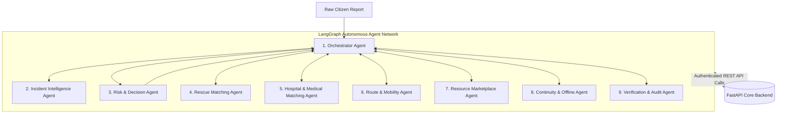

# RESQ — Multi-Agent System Architecture

## 1. Overview & Core Philosophy

The RESQ Agent Tier comprises **nine specialized logical agents** managed via a LangGraph state machine.

> [!IMPORTANT]
> **Deterministic Boundary Rule:** AI agents provide cognitive perception, natural language interpretation, ranking heuristics, and coordination recommendations.
> AI agents **never directly mutate the database** and **never execute unvalidated clinical or resource reservations**.
> All mutations occur via strict, authenticated Backend REST APIs enforcing deterministic capacity calculations and access controls.

---

## 2. Agent Catalog & Specifications

---

### 1. Orchestrator Agent
- **Purpose:** Central coordinator for incident lifecycle state transitions and inter-agent task delegation.
- **Inputs:** Incident lifecycle events, agent output artifacts, human intervention signals.
- **Outputs:** State machine transition actions, dispatched sub-agent triggers, control-room alerts.
- **Responsibilities:**
  - Manages the LangGraph execution graph for each active incident.
  - Ensures correct sequencing: Intelligence $\rightarrow$ Risk $\rightarrow$ Matching $\rightarrow$ Dispatch $\rightarrow$ Audit.
  - Detects timeouts or hanging agent nodes and triggers fallbacks.
- **Backend APIs Used:**
  - `GET /api/v1/incidents/{id}`
  - `POST /api/v1/incidents/{id}/tasks`
  - `POST /api/v1/agent-events`
- **Inter-Agent Communication:** Direct supervisor for Agents 2 through 9.
- **Failure Handling:** Times out after 30 seconds of inactivity per stage; falls back to manual control-room dispatch queue.
- **Human-Approval Requirements:** Mass casualty incidents ($>10$ victims) or critical priority conflicts require control-room officer sign-off before automated task dispatch.

---

### 2. Incident Intelligence Agent
- **Purpose:** Ingest unstructured citizen reports (text, voice transcripts, SMS) and extract structured incident entities.
- **Inputs:** Raw report text, user submitted location metadata, attached media tags.
- **Outputs:** Structured `IncidentExtraction` object (hazard type, victim count, medical conditions, trapped status, urgent keywords).
- **Responsibilities:**
  - Normalizes informal language, local dialects (e.g., Malayalam emergency terms), and ambiguous descriptions.
  - Detects potential duplicates by querying backend for nearby incidents.
- **Backend APIs Used:**
  - `GET /api/v1/incidents/duplicates?lat={lat}&lng={lng}&radius_m=200`
  - `PATCH /api/v1/incidents/{id}/intelligence`
- **Inter-Agent Communication:** Communicates outputs to Orchestrator and Risk & Decision Agent.
- **Failure Handling:** If report parsing confidence $<0.6$, flags report as `AMBIGUOUS` and routes to emergency operator queue with highlighted uncertainties.
- **Human-Approval Requirements:** None for extraction; human required if flagged ambiguous.

---

### 3. Risk & Decision Agent
- **Purpose:** Assess hazard severity, victim vulnerability, and determine the required response pathways.
- **Inputs:** Structured incident data, environmental risk factors (water level, weather warnings).
- **Outputs:** Triage Priority (`CRITICAL`, `HIGH`, `MEDIUM`, `LOW`), confidence score, and a list of required `TaskRecommendations`.
- **Responsibilities:**
  - Employs deterministic clinical triage protocols (SALT/START).
  - Identifies multi-pathway response requirements (e.g., Boat Rescue + ALS Ambulance + Pediatric ICU).
- **Backend APIs Used:**
  - `POST /api/v1/incidents/{id}/tasks/propose`
- **Inter-Agent Communication:** Receives from Intelligence Agent; directs Orchestrator to instantiate matching agents.
- **Failure Handling:** Defaults to highest defensible priority tier (`HIGH`) when ambiguous life-threat symptoms are present.
- **Human-Approval Requirements:** Downgrading a citizen-reported life threat to `LOW` priority requires explicit human supervisor confirmation.

---

### 4. Rescue Matching Agent
- **Purpose:** Identify, rank, and recommend available rescue teams and equipment for physical extraction tasks.
- **Inputs:** Task specification (extraction type: flood boat, mountain rope, collapsed structure), target coordinates, urgency level.
- **Outputs:** Ranked list of `RescueTeamRecommendation` with proximity, capability match, and ETA.
- **Responsibilities:**
  - Queries active rescue units via spatial backend endpoints.
  - Filters out units already engaged or lacking required gear (e.g., motorized inflatable boats).
- **Backend APIs Used:**
  - `GET /api/v1/resources/rescue-teams?capability={cap}&lat={lat}&lng={lng}&status=AVAILABLE`
  - `POST /api/v1/tasks/{id}/assign`
- **Inter-Agent Communication:** Coordinates with Route & Mobility Agent for realistic travel estimates.
- **Failure Handling:** If no teams are within 25km radius, widens search to adjacent district clusters and issues regional mutual-aid alert.
- **Human-Approval Requirements:** Reallocating a rescue team currently assigned to another active rescue requires control-room authorization.

---

### 5. Hospital & Medical Matching Agent
- **Purpose:** Identify suitable receiving healthcare facilities and coordinate ambulance transport.
- **Inputs:** Patient clinical requirements (e.g., burn unit, pediatric ICU, trauma surgeon, negative-pressure room), location, transport urgency.
- **Outputs:** Recommended Hospital destination, matched Ambulance unit, tentative reservation request.
- **Responsibilities:**
  - Verifies deterministic hospital bed availability via backend.
  - Coordinates linked ambulance dispatch to ensure synchrony with rescue handover.
- **Backend APIs Used:**
  - `GET /api/v1/resources/hospitals/search?specialty={s}&lat={lat}&lng={lng}`
  - `POST /api/v1/resources/reservations`
- **Inter-Agent Communication:** Coordinates with Route & Mobility Agent for travel time vs. medical golden-hour limits.
- **Failure Handling:** If local hospital capacity is zero, triggers regional referral protocol to next nearest tier-1 facility.
- **Human-Approval Requirements:** Receiving hospital triage doctor or control-room medical coordinator must confirm final bed acceptance.

---

### 6. Route & Mobility Agent
- **Purpose:** Compute viable travel routes taking into account disaster-related road closures, flood inundations, and bridge collapses.
- **Inputs:** Origin and destination coordinates, vehicle clearance type (4x4, boat, standard ambulance).
- **Outputs:** Validated route polyline, estimated transit time, hazard waypoint warnings.
- **Responsibilities:**
  - Cross-references routing queries with reported impassable sectors in Kerala flood zones.
  - Never marks a route as safe without positive clearance metadata.
- **Backend APIs Used:**
  - `GET /api/v1/locations/hazards?bbox={bbox}`
- **Inter-Agent Communication:** Supplies travel time matrices to Rescue, Hospital, and Resource Marketplace Agents.
- **Failure Handling:** Flags routes passing through unverified flood zones as `UNVERIFIED_HAZARD` and advises local ground check.
- **Human-Approval Requirements:** Routes traversing active red-alert landslide corridors require incident commander clearance.

---

### 7. Resource Marketplace Agent
- **Purpose:** Autonomous matching and allocation of emergency medical supplies, blood units, oxygen, and relief rations.
- **Inputs:** Supply request (item code, quantity, required by time, recipient location).
- **Outputs:** Allocation plan specifying supplier organization, reservation payload, courier task.
- **Responsibilities:**
  - Discovers certified commercial and NGO suppliers in vicinity.
  - Enforces ethical allocation principles: **Urgency and clinical need override commercial bidding**.
- **Backend APIs Used:**
  - `GET /api/v1/resources/inventory/search?item_type={type}&quantity={qty}`
  - `POST /api/v1/resources/reservations`
- **Inter-Agent Communication:** Coordinates dispatch courier task with Orchestrator.
- **Failure Handling:** Partial fulfillment splitting (e.g., 20 units fulfilled from Supplier A, 30 from Supplier B).
- **Human-Approval Requirements:** Allocations of restricted emergency stockpiles (e.g., rare blood types O-negative or specialized antidotes) require medical officer authorization.

---

### 8. Continuity & Offline Agent
- **Purpose:** Monitor system network health, detect intermittent disconnection of field responders, and oversee reconciliation.
- **Inputs:** Responders' heartbeat ping latency, queued offline sync events.
- **Outputs:** Sync queue replay instructions, conflict detection flags, stale data invalidation notices.
- **Responsibilities:**
  - Manages event sequence re-ordering based on vector clocks and event causality.
  - Validates that offline reservations do not violate server-side capacity state upon reconnect.
- **Backend APIs Used:**
  - `POST /api/v1/sync/events`
  - `GET /api/v1/sync/conflicts`
- **Inter-Agent Communication:** Signals Orchestrator when a field unit reconnects with state mutations.
- **Failure Handling:** Unresolvable conflicts are placed into an isolated quarantine queue for human manual arbitration.
- **Human-Approval Requirements:** Conflict arbitration requiring retroactive invalidation of an assigned task.

---

### 9. Verification & Audit Agent
- **Purpose:** Continuous verification of business invariants, discrepancy detection, and immutable post-incident audit assembly.
- **Inputs:** Incident timeline records, GPS arrival pings, citizen confirmations, inventory consumption receipts.
- **Outputs:** Audit summary report, discrepancy alerts, closure validation token.
- **Responsibilities:**
  - Compares responder self-reported arrival timestamps with citizen confirmation.
  - Confirms all reserved beds/supplies were either utilized or explicitly released back to public availability.
- **Backend APIs Used:**
  - `GET /api/v1/incidents/{id}/timeline`
  - `POST /api/v1/incidents/{id}/close`
  - `POST /api/v1/audit/logs`
- **Inter-Agent Communication:** Final node in the Orchestrator lifecycle graph.
- **Failure Handling:** Halts automatic incident closure if an open task remains in an indeterminate state.
- **Human-Approval Requirements:** Closing an incident with unresolved citizen discrepancies.
