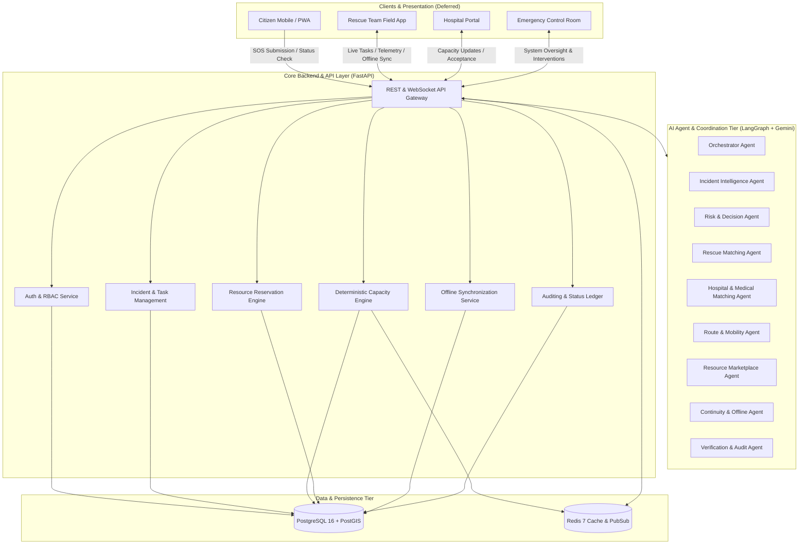
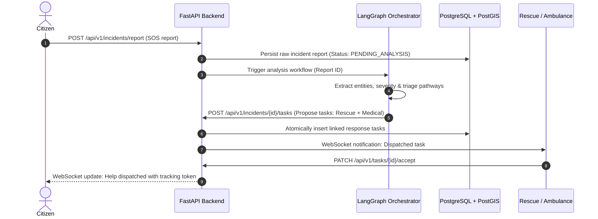

# RESQ — System Architecture Specification

## 1. Executive Summary

**RESQ** is an agentic emergency-response and autonomous resource-coordination platform. Rather than acting as a static reporting dashboard, RESQ operates as an active, distributed multi-agent network that coordinates citizens, rescue teams, emergency medical services, hospitals, blood banks, and relief suppliers in real-time.

A core operational principle of RESQ is that **a single incident frequently requires multiple linked response tasks** (e.g., rescue extraction + ambulance transport + hospital bed reservation + medical supply coordination).

> [!NOTE]
> For the comprehensive full-resolution multi-tier architecture diagrams, state machine flows, and disaster simulation sequences, see [`docs/system-architecture/system-architecture-diagram.md`](system-architecture-diagram.md).

---

## 2. Overall High-Level Architecture

The platform is organized into three distinct tiers:
1. **Presentation Tier (Deferred):** Role-specific progressive web applications (Citizen, Rescue, Healthcare, Control Room, Admin).
2. **Coordination & Agent Tier (Developer 2):** LangGraph-powered AI agents executing reasoning, extraction, matching, and multi-pathway coordination.
3. **Core Services & State Tier (Developer 1):** FastAPI application, PostgreSQL + PostGIS spatial database, Redis caching/pubsub, deterministic capacity engines, and offline reconciliation.

---

## 3. Component Communication & Interactions

### 3.1 Synchronous Communication
- **Client to Backend:** HTTP/2 REST APIs via JSON over TLS.
- **Agent to Backend:** Typed internal HTTP client communicating with authenticated `/api/v1` endpoints.
- **Safety Boundary:** AI Agents **never** write directly to the database. All state mutations and reservations occur through backend API endpoints that enforce business rules, transaction isolation, and permissions.

### 3.2 Asynchronous & Real-Time Communication
- **WebSockets:** `/ws/incidents/{id}`, `/ws/control-room`, and `/ws/responders/{id}` for real-time telemetry, live dispatch updates, and arrival confirmations.
- **Redis Pub/Sub:** Serves as the internal message broker broadcasting events across multiple FastAPI workers and WebSocket channels.

---

## 4. Deterministic Capacity & Resource Isolation

A critical system constraint is the **prevention of hallucinations in resource allocation**:
1. Capacity is **calculated deterministically**, never estimated by LLMs:
   $$\text{Available Beds} = \text{Total Beds} - \text{Occupied Beds} - \text{Reserved Beds} - \text{OutOfService Beds}$$
2. Bed decrement does not happen on task assignment; it requires an explicit **time-bounded reservation** followed by hospital confirmation upon physical admission.
3. Multi-tenancy isolation guarantees that Organizations (Hospitals, NGOs, Ambulance Fleets) can only manipulate their own internal capacity and inventory.

---

## 5. Offline Architecture & Conflict Resolution

In disaster scenarios (e.g., floods, landslides), network connectivity is intermittent.
- Field devices queue operations locally in an offline event journal.
- Each event has a cryptographically secure UUIDv4 and client generation timestamp.
- When reconnected, events synchronize via `POST /api/v1/sync/events`.
- **Conflict Resolution Rule:** Newer timestamps are **not** unconditionally authoritative.
  - Critical safety resources (hospital beds, blood units) reject stale allocations.
  - Incident status moves forward according to state machine transition graphs; backwards illegal transitions are rejected and flagged for manual audit.

---

## 6. Security Boundaries & RBAC

1. **Public Zone:** Anonymous SOS submission and tokenized tracking. No password required for citizens in distress.
2. **Responder Zone:** JWT-authenticated rescue teams and ambulance drivers with device ID verification.
3. **Healthcare & Supplier Zone:** Strict organization-scoped tokens. Operations limited to internal inventory and authorized incident transfers.
4. **Control Room & Admin Zone:** System-wide visibility, manual override capabilities, and audit ledger access.
5. **Agent Boundary:** System Service API token with strict rate limits and sandbox boundaries. Agents cannot bypass backend validation.

---

## 7. Deployment Architecture

- **Backend Container:** Dockerized FastAPI service deployed to Google Cloud Run or Kubernetes.
- **Database:** Managed PostgreSQL 16 instance with PostGIS extension (e.g., Cloud SQL).
- **Cache/Broker:** Managed Redis instance (e.g., Google Cloud Memorystore).
- **AI Agent Execution:** Worker processes running LangGraph state machines calling Google Gemini via API.
