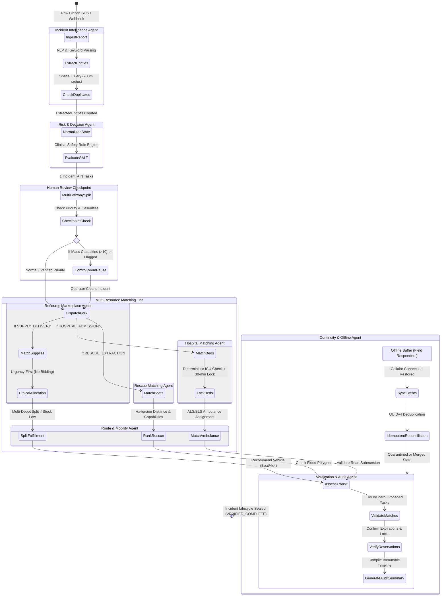
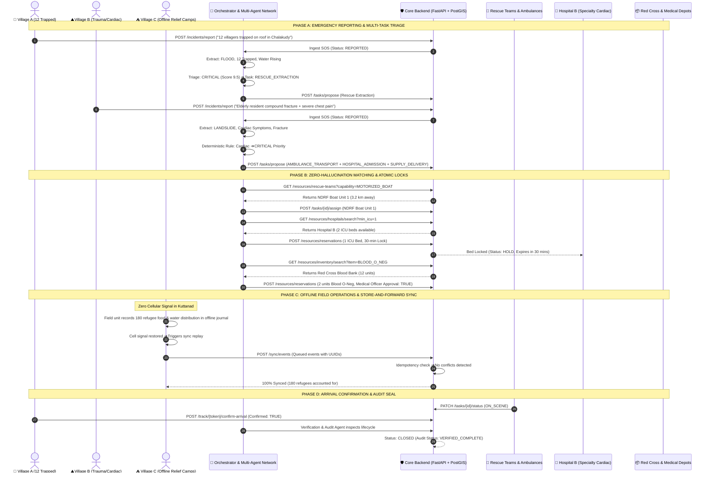

# RESQ — Master System Architecture & Multi-Agent Network Diagram

> This document provides the complete, authoritative architectural diagrams for the **RESQ** autonomous emergency response platform, covering end-to-end multi-agent orchestration, core backend services, deterministic safety boundaries, and disaster resilience protocols.

---

## 1. Complete End-to-End Platform Architecture

The diagram below details the 4-tier architecture of RESQ, highlighting how clients, autonomous AI agents, deterministic backend services, and geospatial databases interact across secure boundaries.

```mermaid
flowchart TB
    %% =========================================================================
    %% STYLING & CLASSES
    %% =========================================================================
    classDef clientTier fill:#E8F0FE,stroke:#4285F4,stroke-width:2px,color:#1A73E8;
    classDef agentTier fill:#FEF7E0,stroke:#F9AB00,stroke-width:2px,color:#B06000;
    classDef backendTier fill:#E6F4EA,stroke:#34A853,stroke-width:2px,color:#137333;
    classDef dbTier fill:#FCE8E6,stroke:#EA4335,stroke-width:2px,color:#C5221F;
    classDef safetyBoundary fill:#FFF8E1,stroke:#FF6F00,stroke-width:2px,stroke-dasharray: 5 5;

    %% =========================================================================
    %% 1. PRESENTATION & CLIENT TIER
    %% =========================================================================
    subgraph Tier1["1. PRESENTATION & ACTOR TIER (Web, PWA & Field Hardware)"]
        CitizenPortal["📱 Citizen SOS Web / PWA\n(Anonymous SOS, GPS Landmark, Live Tracking Token)"]:::clientTier
        RescueFieldApp["🚤 Rescue Responder Mobile PWA\n(Offline Event Journal, Task Execution, GPS Telemetry)"]:::clientTier
        HospitalPortal["🏥 Hospital & Triage Console\n(Deterministic Bed Availability, Admission Confirmation)"]:::clientTier
        SupplierPortal["📦 Supplier & Blood Bank Depot\n(Inventory Tracking, Dispatch Confirmation, Courier Handshake)"]:::clientTier
        ControlRoomUI["🖥️ Emergency Control Room\n(Situational Geospatial Map, Override & Human Approval Gate)"]:::clientTier
    end

    %% =========================================================================
    %% 2. AGENTIC ORCHESTRATION TIER
    %% =========================================================================
    subgraph Tier2["2. AGENTIC ORCHESTRATION TIER (LangGraph + Gemini Cognitive Engine)"]
        Orchestrator["👑 1. Orchestrator Agent\n(Central LangGraph Supervisor & Workflow Pipeline)"]:::agentTier

        subgraph CognitivePerception["Perception & Triage"]
            IntelligenceAgent["🧠 2. Incident Intelligence Agent\n(NLP Entity Extraction, Local Slang/Kerala Dialects, Deduplication)"]:::agentTier
            RiskDecisionAgent["⚖️ 3. Risk & Decision Agent\n(Deterministic SALT/START Triage, 1 Incident ➔ N Linked Tasks)"]:::agentTier
            HumanReviewGate{"⚠️ Human-in-the-Loop Gate\n(Mass Casualty >10 / Ambiguity Checkpoint)"}:::safetyBoundary
        end

        subgraph ResourceMatchingEngine["Multi-Resource Autonomous Matching"]
            RescueMatchingAgent["🚤 4. Rescue Matching Agent\n(Capability Filtering: Boat/Diver, Haversine Spatial Ranking)"]:::agentTier
            HospitalMatchingAgent["🏥 5. Hospital & Medical Matching\n(ICU Bed Selection, ALS/BLS Ambulance Sync, 30-min Lock)"]:::agentTier
            RouteMobilityAgent["🗺️ 6. Route & Mobility Agent\n(Hazard Polygon Avoidance, Submerged Bridge Clearance)"]:::agentTier
            ResourceMarketplaceAgent["💊 7. Resource Marketplace Agent\n(Ethical Non-Commercial Allocation, Split-Supplier Fulfillment)"]:::agentTier
        end

        subgraph ResilienceAndAudit["Resilience & Governance"]
            ContinuityOfflineAgent["📡 8. Continuity & Offline Agent\n(Store-and-Forward Replay, Idempotency, Conflict Resolution)"]:::agentTier
            VerificationAuditAgent["🛡️ 9. Verification & Audit Agent\n(Dual-Ack Citizen/Responder Validation, Immutable Ledger Seal)"]:::agentTier
        end
    end

    %% =========================================================================
    %% 3. CORE BACKEND & API GATEWAY TIER
    %% =========================================================================
    subgraph Tier3["3. CORE BACKEND & API GATEWAY TIER (FastAPI 0.110+)"]
        APIGateway["🌐 FastAPI Gateway & Auth Middleware\n(JWT RBAC, Tracking Token Security, Rate Limiter)"]:::backendTier

        subgraph BackendServices["Deterministic Business Logic Services"]
            IncidentService["📋 Incident & Task Lifecycle Service\n(Atomic Multi-Task Spawner, Tracking Tokens)"]:::backendTier
            DeterministicCapacityEngine["🧮 Deterministic Capacity Engine\n(Available = Total - Occupied - Reserved - OutOfService)"]:::backendTier
            AtomicReservationService["🔒 Atomic Reservation Lock Service\n(Time-bounded 30-min Locks, Auto-expiry Worker)"]:::backendTier
            OfflineReconciliationService["🔄 Offline Reconciliation Engine\n(UUID Idempotency, Stale Allocation Quarantine)"]:::backendTier
            AuditService["📜 Immutable Audit & Event Ledger\n(Dual-Acknowledgment Reconciliation, Timeline Logger)"]:::backendTier
            RealtimeBroadcaster["⚡ Real-time Telemetry & PubSub\n(WebSockets Manager: /ws/incidents, /ws/telemetry)"]:::backendTier
        end
    end

    %% =========================================================================
    %% 4. PERSISTENCE & CACHING TIER
    %% =========================================================================
    subgraph Tier4["4. PERSISTENCE & DATA STORAGE TIER"]
        PostgresPostGIS[("🐘 PostgreSQL 16 + PostGIS\n- incidents & response_tasks\n- organizations & hospital_capacity\n- resource_inventory & resource_reservations\n- audit_logs & status_events\n- GIST Spatial Indexes")]:::dbTier
        RedisCache[("⚡ Redis 7 In-Memory Broker\n- Real-time PubSub Broadcast\n- Rate Limiting Counters\n- Ephemeral Cache & Heartbeats")]:::dbTier
    end

    %% =========================================================================
    %% TIER-TO-TIER CONNECTIONS
    %% =========================================================================
    %% Clients to Backend
    CitizenPortal -->|"HTTPS POST /incidents/report\nGET /incidents/track/{token}"| APIGateway
    RescueFieldApp <-->|"WSS /ws/telemetry\nPOST /sync/events"| APIGateway
    HospitalPortal <-->|"HTTPS PATCH /capacity\nPATCH /tasks/{id}/accept"| APIGateway
    SupplierPortal <-->|"HTTPS PATCH /inventory\nPATCH /reservations/{id}/fulfill"| APIGateway
    ControlRoomUI <-->|"WSS /ws/control-room\nPOST /interventions/override"| APIGateway

    %% Backend to Agents
    APIGateway <-->|"Typed Async HTTP Client\n(Bearer Token Auth)"| Orchestrator

    %% Orchestrator Internal Pipeline
    Orchestrator --> IntelligenceAgent
    IntelligenceAgent --> RiskDecisionAgent
    RiskDecisionAgent --> HumanReviewGate
    HumanReviewGate -->|"Approved / Auto"| RescueMatchingAgent
    HumanReviewGate -->|"Approved / Auto"| HospitalMatchingAgent
    HumanReviewGate -->|"Approved / Auto"| ResourceMarketplaceAgent
    HumanReviewGate -->|"Requires Sign-off"| ControlRoomUI
    RescueMatchingAgent --> RouteMobilityAgent
    HospitalMatchingAgent --> RouteMobilityAgent
    ResourceMarketplaceAgent --> RouteMobilityAgent
    RouteMobilityAgent --> VerificationAuditAgent
    ContinuityOfflineAgent -.->|"Sync Replay"| Orchestrator

    %% Agent Tier to Backend Services
    IntelligenceAgent -->|"Check Duplicates"| IncidentService
    RiskDecisionAgent -->|"Propose Multi-Pathway Tasks"| IncidentService
    RescueMatchingAgent -->|"Query Spatial Units"| IncidentService
    HospitalMatchingAgent -->|"Search Verified Beds"| DeterministicCapacityEngine
    HospitalMatchingAgent -->|"Create Bed Lock"| AtomicReservationService
    ResourceMarketplaceAgent -->|"Create Supply Lock"| AtomicReservationService
    ContinuityOfflineAgent -->|"Replay Events"| OfflineReconciliationService
    VerificationAuditAgent -->|"Seal Record"| AuditService

    %% Backend Gateway to Services
    APIGateway --> IncidentService
    APIGateway --> DeterministicCapacityEngine
    APIGateway --> AtomicReservationService
    APIGateway --> OfflineReconciliationService
    APIGateway --> AuditService
    APIGateway --> RealtimeBroadcaster

    %% Services to Database Tier
    IncidentService -->|"SQL / PostGIS ST_DWithin"| PostgresPostGIS
    DeterministicCapacityEngine -->|"Strict Column Check Constraints"| PostgresPostGIS
    AtomicReservationService -->|"SELECT FOR UPDATE (Row Locks)"| PostgresPostGIS
    OfflineReconciliationService -->|"Idempotent Upserts"| PostgresPostGIS
    AuditService -->|"Append-Only Immutable Inserts"| PostgresPostGIS
    RealtimeBroadcaster <-->|"PubSub Channel Streams"| RedisCache
```

---

## 2. Multi-Agent Lifecycle & LangGraph State Machine

This diagram traces the exact node transitions, conditional edges, and human checkpoints executed by the LangGraph state machine:

---

## 3. Disaster Simulation Data Flow (Kerala Flood Baseline)

The data flow illustrating how the platform coordinates the three baseline disaster nodes defined in Section 8 of the Master Specification:

---

## 4. Key Architectural Guarantees & Safeguards

| Component | Architecture Guarantee | Implementation |
| :--- | :--- | :--- |
| **Capacity Integrity** | **Zero-Hallucination Policy** | Large Language Models never compute or modify inventory. Calculated strictly via SQL: `Total - Occupied - Reserved - OutOfService`. |
| **Double-Booking Prevention** | **Atomic Time-Bounded Locks** | Bed and supply allocations use temporary 30-minute holds (`status: HOLD`) that expire automatically if not confirmed by admission. |
| **Clinical Safety** | **Deterministic Triage Invariants** | Critical conditions (cardiac arrest, arterial bleed) deterministically trigger `CRITICAL` priority; LLMs are barred from downgrading life-threats. |
| **Marketplace Ethics** | **Non-Commercial Disaster Allocation** | Highest-bid-wins is strictly forbidden. Priority follows clinical urgency $\rightarrow$ proximity $\rightarrow$ stock availability. |
| **Offline Synchronization** | **Causality & Idempotency** | Field units queue operations with UUIDv4. Server rejects illegal retroactive capacity claims and ignores duplicate submissions. |
