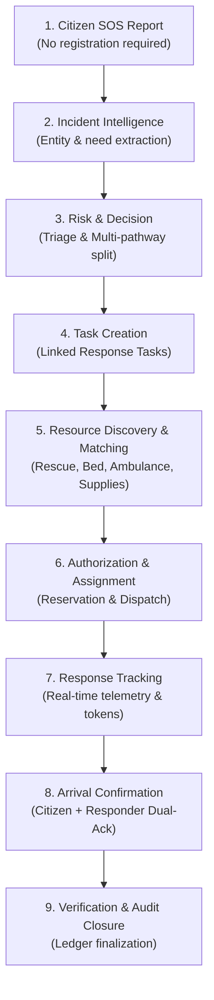

# RESQ — End-to-End Emergency Response Workflow

This document details the lifecycle of an emergency event in RESQ, tracing the progression from initial citizen contact through multi-pathway resolution, arrival reconciliation, and audit closure.

---

## Complete Workflow Lifecycle

---

## Detailed Stage Breakdown

### Stage 1: Citizen SOS Report
- **Trigger:** Citizen opens web/PWA interface or submits via SMS/IVR gateway.
- **Data Provided:** Freeform text/voice description, GPS coordinates (or landmark string), contact phone (optional), photo/media (optional).
- **Backend Responsibility:**
  - Generate a secure, unique `incident_id` (UUIDv4) and a cryptographically secure `tracking_token`.
  - Persist raw payload in `incident_reports` table with initial status `REPORTED`.
  - Issue tracking URL to citizen: `https://resq.org/track/{tracking_token}`.
  - Emit internal event `incident.reported` via Redis.

### Stage 2: Incident Intelligence
- **Trigger:** Ingestion of raw incident report.
- **Agent Responsible:** `Incident Intelligence Agent`.
- **Processing:**
  - Extracts key entities: Hazard type (flood, landslide, fire), number of victims trapped/injured, medical urgencies (bleeding, hypothermia, cardiac), environmental hazards (power lines, rising water).
  - Normalizes geographic location to verified coordinate boundaries.
  - Queries backend for duplicate incident proximity (within 100m in past 60 minutes).
- **Backend Responsibility:**
  - Update `incidents` record with structured parameters (`severity_hint`, `people_affected`, `hazard_flags`).

### Stage 3: Risk & Decision Analysis
- **Trigger:** Structured incident data available.
- **Agent Responsible:** `Risk & Decision Agent`.
- **Processing:**
  - Evaluates clinical and physical urgency using deterministic triage rules (e.g., START/SALT triage protocols) combined with environmental context.
  - Computes priority level (`CRITICAL`, `HIGH`, `MEDIUM`, `LOW`).
  - **Multi-Pathway Determination:** Identifies all concurrent response streams required.
- **Backend Responsibility:**
  - Enforce system validation: Ensure critical priority thresholds mandate human control-room alert flags.

### Stage 4: Multi-Pathway Task Creation
- **Principle:** One incident can produce multiple linked tasks.
- **Example Scenario:** Flooded house with elderly patient with chest pains.
  - Task 1: `RESCUE_EXTRACTION` (Boat team required).
  - Task 2: `AMBULANCE_TRANSPORT` (Advanced Life Support ambulance).
  - Task 3: `HOSPITAL_ADMISSION` (Emergency ICU/Cardiology acceptance).
  - Task 4: `SUPPLY_DISPATCH` (Oxygen canister reserve).
- **Backend Responsibility:**
  - Atomically create records in `response_tasks` table linked by `incident_id`.
  - Establish parent-child task dependencies (e.g., Task 2 Ambulance is timed to meet Task 1 Rescue at extraction landing point).

### Stage 5: Resource Discovery & Matching
- **Agents Responsible:**
  - `Rescue Matching Agent`: Discovers teams by radius, equipment (boats, divers), and active load.
  - `Hospital & Medical Matching Agent`: Discovers hospitals with confirmed available beds in required specialties.
  - `Route & Mobility Agent`: Verifies passable corridors avoiding flood inundation zones.
  - `Resource Marketplace Agent`: Locates blood units, oxygen, or specialized drugs from nearest verified depots.
- **Backend Responsibility:**
  - Execute spatial queries (`ST_DWithin` on PostGIS indexes).
  - Check deterministic availability without hallucination.

### Stage 6: Authorization & Assignment
- **Processing:**
  - Hospital beds and inventory items enter a temporary `RESERVED` state (e.g., 30-minute lock).
  - Dispatch proposals sent to responder mobile units and hospital admin dashboards.
- **Backend Responsibility:**
  - Atomically execute reservations in `resource_reservations` table to prevent double-booking.
  - Update `response_tasks` status to `ASSIGNED`.
  - Push real-time notification to selected teams.

### Stage 7: Response Tracking & Live Telemetry
- **Processing:**
  - Responders mark status: `ACCEPTED` $\rightarrow$ `EN_ROUTE` $\rightarrow$ `ON_SCENE` $\rightarrow$ `TRANSPORTING` $\rightarrow$ `COMPLETED`.
  - GPS telemetry streamed at regular intervals.
- **Backend Responsibility:**
  - Ingest telemetry via WebSocket `/ws/telemetry`.
  - Stream sanitized progress updates to citizen's tracking view (masking responder personal information).
  - Write event updates into `status_events` journal.

### Stage 8: Arrival & Delivery Confirmation
- **Dual-Confirmation Mechanism:**
  - Responder marks `ARRIVED_ON_SCENE` or `PATIENT_HANDED_OVER`.
  - Citizen or Receiving Hospital acknowledges confirmation via tracking token or hospital interface.
  - If discrepancy occurs (e.g., responder reports arrived, but citizen disputes within 5 minutes), the task is escalated to Control Room with a `DISCREPANCY_FLAG`.
- **Backend Responsibility:**
  - Record independent arrival timestamps.
  - Reconcile status only when validation passes.

### Stage 9: Verification & Audit Closure
- **Trigger:** All linked tasks for an incident reach terminal status (`COMPLETED` or `CANCELLED`).
- **Agent Responsible:** `Verification & Audit Agent`.
- **Processing:**
  - Compiles full transaction timeline: report receipt, triage decisions, reservations, dispatches, actual admissions, and consumable usage.
  - Verifies that all reservations were converted to admissions or released back into inventory.
- **Backend Responsibility:**
  - Seal incident status as `CLOSED`.
  - Write immutable record into `audit_logs`.
