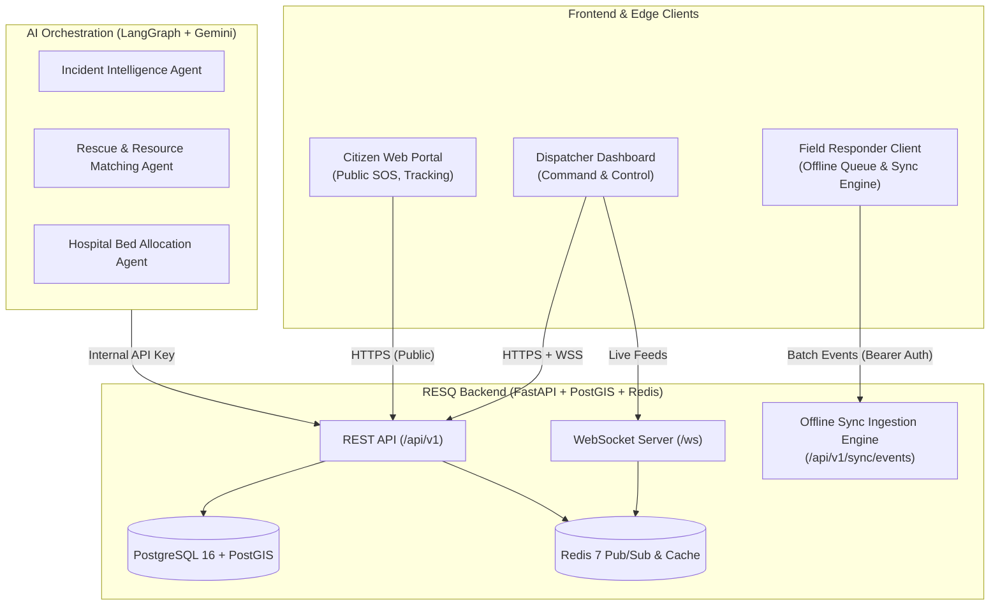

# RESQ Team Handoff & Developer Collaboration Guide

Welcome to the **RESQ Disaster Coordination & Emergency Response Platform**.

This guide provides the complete setup, credentials, and API specifications required for:
1. **Hosting & Accessing the Backend** across different laptops (Local LAN, Cloudflare/Ngrok Tunnel, or Cloud Deployment).
2. **Friend A (Offline Field Sync Developer)**: Building the field responder offline-first queue and synchronization engine.
3. **Friend B (Frontend Developer)**: Building the Citizen SOS portal, Dispatcher Command Dashboard, and Responder PWA.

---

## 1. System Architecture & Repositories

- **GitHub Repository**: `https://github.com/Pavan-Gowda-S/Resq.git`
- **Main Branch**: `main`
- **Current State**: Backend (Phases 1–7) is fully implemented and passes all 101 unit/integration tests. AI Agents are integrated and verified end-to-end.



---

## 2. Exposing the Backend to External Laptops

Since your backend is running locally, your teammates can connect to it using any of the following options:

### Option A: Cloudflare Tunnel or Ngrok (Recommended - Instant & Free)
To expose your currently running backend (`http://localhost:8000`) securely to the internet without touching router settings:

**Using Cloudflare Tunnel (no account required):**
```bash
# In PowerShell:
winget install Cloudflare.cloudflared
cloudflared tunnel --url http://localhost:8000
```
*Cloudflare will print a public HTTPS URL (e.g., `https://resq-emergency-abc.trycloudflare.com`). Share this URL with your teammates!*

**Using Ngrok:**
```bash
ngrok http 8000
```
*Share the resulting `https://<subdomain>.ngrok-free.app` URL.*

---

### Option B: Local WiFi / LAN Access
If both laptops are on the same Wi-Fi network:
1. Find your local IP in PowerShell:
   ```powershell
   ipconfig
   # Look for IPv4 Address, e.g., 192.168.1.45
   ```
2. Ensure Uvicorn is bound to `0.0.0.0` (already configured in `docker-compose.yml` and `start-backend` scripts).
3. Teammates can connect directly via: `http://192.168.1.45:8000`

---

### Option C: Cloud Deployment (Railway or Render)
The repository includes configuration files for one-click cloud hosting:
- `railway.toml`: Ready for [Railway.app](https://railway.app) (connect GitHub repo, provision PostgreSQL + Redis addons).
- `render.yaml`: Ready for [Render.com](https://render.com).
- `Dockerfile`: Standalone Docker container for any cloud VPS.

---

### Option D: Running Entirely Locally on Their Own Laptop
If your teammate has Docker installed on their laptop, they can clone the repo and run everything locally:
```bash
git clone https://github.com/Pavan-Gowda-S/Resq.git
cd Resq
copy .env.example .env
docker compose up -d
```
The database, Redis, and FastAPI server will start automatically with schema and seed data loaded!

---

## 3. Pre-Seeded Test Accounts & Credentials

The database comes pre-seeded with test users across all disaster response roles:

| Role | Email | Password | Intended Portal / Use |
|---|---|---|---|
| **SUPERADMIN** | `superadmin@resq.gov.in` | `Admin@123456` | Full platform access & system config |
| **CONTROL_ROOM_DISPATCHER** | `dispatcher@ernakulam.resq.gov.in` | `Dispatch@123` | Dispatcher Command Dashboard, Task Assignment |
| **ORG_ADMIN** | `hospitaladmin@general.resq.gov.in` | `Hospital@123` | Hospital Admin Portal, Bed Management |
| **TRIAGE_DOCTOR** | `doctor@wayanad.resq.gov.in` | `Doctor@123` | Emergency Room / Patient Triage |
| **FIELD_RESPONDER** | `responder01@ndrf.resq.gov.in` | `Rescue@123` | NDRF Rescue Field App & Offline Sync |
| **FIELD_RESPONDER** | `ambulance01@108.resq.gov.in` | `Ambulance@123` | 108 Ambulance Dispatch & En-Route App |

**AI Agent System API Key:**
```
X-API-Key: resq_agent_internal_secret_token
```

---

## 4. Instructions for Friend A: Offline Field Sync

### Purpose
In natural disasters (e.g., floods, landslides), network coverage is intermittent. Field responders need an app that queues status changes, GPS location updates, and arrival confirmations locally (in SQLite, Room, or IndexedDB) and flushes them to the server when connectivity returns.

### Step-by-Step Setup
1. Clone the repository:
   ```bash
   git clone https://github.com/Pavan-Gowda-S/Resq.git
   cd Resq
   ```
2. Create your feature branch:
   ```bash
   git checkout -b feature/offline-sync-client
   ```
3. Target Base URL:
   `http://<SERVER_IP_OR_PUBLIC_TUNNEL_URL>:8000/api/v1`

### Authentication
Authenticate first to get your JWT Bearer token:
```http
POST /api/v1/auth/login
Content-Type: application/x-www-form-urlencoded

username=responder01@ndrf.resq.gov.in&password=Rescue@123
```
Response:
```json
{
  "access_token": "eyJhbGciOiJIUzI1NiIsIn...",
  "token_type": "bearer"
}
```

### The Offline Batch Sync API Contract
- **Endpoint**: `POST /api/v1/sync/events`
- **Headers**:
  - `Authorization: Bearer <access_token>`
  - `Content-Type: application/json`
- **Batch Size**: 1 to 50 events per request.
- **Idempotency**: Every event **must** have a client-generated UUIDv4 `event_id`. If the same event is submitted again due to network retries, the server recognizes it from the audit log and returns success without duplicating state.

#### Request Schema:
```json
{
  "device_id": "device-ndrf-pixel-01",
  "events": [
    {
      "event_id": "f47ac10b-58cc-4372-a567-0e02b2c3d479",
      "entity_type": "TASK",
      "entity_id": "c138f51a-7b3c-418a-939e-4c74a0eef011",
      "action": "UPDATE_STATUS",
      "payload": {
        "status": "ACCEPTED"
      },
      "client_timestamp": "2026-10-31T14:30:00Z"
    },
    {
      "event_id": "b18ac20b-68cc-4372-b567-1e02b2c3d480",
      "entity_type": "TASK",
      "entity_id": "c138f51a-7b3c-418a-939e-4c74a0eef011",
      "action": "UPDATE_LOCATION",
      "payload": {
        "location": {
          "type": "Point",
          "coordinates": [76.2711, 10.8505]
        }
      },
      "client_timestamp": "2026-10-31T14:32:00Z"
    },
    {
      "event_id": "e29bc30c-78dd-4372-c567-2e02b2c3d481",
      "entity_type": "TASK",
      "entity_id": "c138f51a-7b3c-418a-939e-4c74a0eef011",
      "action": "UPDATE_STATUS",
      "payload": {
        "status": "ON_SCENE"
      },
      "client_timestamp": "2026-10-31T14:40:00Z"
    }
  ]
}
```

#### Supported Actions & Entities:
1. `UPDATE_STATUS` on `TASK`:
   - Valid status values: `ACCEPTED`, `EN_ROUTE`, `ON_SCENE`, `COMPLETED`
2. `UPDATE_LOCATION` on `TASK`:
   - Payload: `{"location": {"type": "Point", "coordinates": [lng, lat]}}`
3. `CONFIRM_ARRIVAL` on `TASK`:
   - Sets citizen/responder verified arrival flag.
4. `UPDATE_STATUS` on `INCIDENT`:
   - Valid values: `TRIAGED`, `DISPATCHED`, `RESOLVED`, `CLOSED`

#### Response Schema:
```json
{
  "synced_count": 3,
  "rejected_count": 0,
  "conflicts": []
}
```

If an event fails (e.g. invalid task ID or forbidden state transition), the server operates under **partial success**:
```json
{
  "synced_count": 2,
  "rejected_count": 1,
  "conflicts": [
    {
      "event_id": "invalid-uuid-here",
      "reason": "Task not found: 00000000-0000-0000-0000-000000000000",
      "current_status": null
    }
  ]
}
```

---

## 5. Instructions for Friend B: Frontend Development

### Interactive Swagger Docs
Open the interactive Swagger UI directly in your browser:
- **Swagger UI**: `http://<HOST>:8000/docs`
- **ReDoc**: `http://<HOST>:8000/redoc`
- **OpenAPI JSON**: `http://<HOST>:8000/openapi.json`

### Key Portals to Build

#### 1. Public Citizen SOS Portal (No Login Required)
- **Report Emergency**:
  ```http
  POST /api/v1/incidents/report
  Content-Type: application/json

  {
    "description": "Rising floodwaters trapped 4 people on the roof.",
    "location": {
      "type": "Point",
      "coordinates": [76.2711, 10.8505]
    },
    "reporter_name": "Ravi Nair",
    "reporter_phone": "+919876543210",
    "num_people_affected": 4
  }
  ```
  *Response returns a secure `tracking_token`.*

- **Live Public Tracking Page**:
  ```http
  GET /api/v1/incidents/track/{tracking_token}
  ```
  *Displays incident status, assigned responder unit, and estimated arrival.*

- **Citizen Arrival Confirmation**:
  ```http
  POST /api/v1/incidents/track/{tracking_token}/confirm-arrival
  ```
  *Allows citizens to confirm when the rescue boat or ambulance actually arrives.*

---

#### 2. Dispatcher Command & Control Dashboard
Requires `CONTROL_ROOM_DISPATCHER` or `SUPERADMIN` login.
- **Get Incidents Feed**: `GET /api/v1/incidents?status=REPORTED&limit=20`
- **Spatial Duplicate Detection**: `GET /api/v1/incidents/duplicates?lat=10.8505&lng=76.2711&radius_m=1000`
- **Find Available Rescue Teams**: `GET /api/v1/resources/rescue-teams?capability=WATER_RESCUE`
- **Query Hospital Beds**: `GET /api/v1/resources/hospitals/beds?lat=10.8505&lng=76.2711&radius_km=25&bed_type=ICU`
- **Create 30-min Atomic Bed Reservation**:
  ```http
  POST /api/v1/resources/reservations
  Authorization: Bearer <token>
  Content-Type: application/json

  {
    "hospital_id": "<uuid>",
    "incident_id": "<uuid>",
    "bed_type": "ICU",
    "quantity": 1
  }
  ```
- **Propose & Assign Task**:
  ```http
  POST /api/v1/incidents/{incident_id}/tasks/propose
  Authorization: Bearer <token>
  ```

---

#### 3. Real-Time WebSockets
Connect to live WebSocket streams to update UI components instantly without polling:

- **Incident Activity Stream**:
  ```javascript
  const token = localStorage.getItem("access_token");
  const ws = new WebSocket(`ws://${HOST}/ws/incidents?token=${token}`);

  ws.onmessage = (event) => {
    const data = JSON.parse(event.data);
    console.log("Real-time incident event:", data);
  };
  ```

- **Specific Task Updates**:
  ```javascript
  const ws = new WebSocket(`ws://${HOST}/ws/tasks/${taskId}?token=${token}`);
  ```

---

## 6. Rate Limiting Guidelines for Frontend
The backend enforces rate limits on public endpoints to prevent abuse:
- `POST /api/v1/auth/login`: 10 requests / minute per IP
- `POST /api/v1/incidents/report`: 5 requests / minute per IP
- `POST /api/v1/incidents/track/{token}/confirm-arrival`: 20 requests / minute per IP

If a rate limit is exceeded, HTTP `429 Too Many Requests` is returned. Ensure your frontend gracefully shows a cooldown warning.

---

## 7. Recommended Workflow & Git Rules

1. **Keep `main` stable**: Never push broken code to `main`.
2. **Branch naming**:
   - `feature/offline-sync-engine` (for Friend A)
   - `feature/frontend-portal` (for Friend B)
3. **Environment Secrets**: Never commit `.env` or personal API keys. Always use `.env.example` as the template.
4. **Coordinate Integration**: When Friend A finishes offline sync, they submit a Pull Request. Friend B can then merge and consume the verified endpoints on the frontend!
