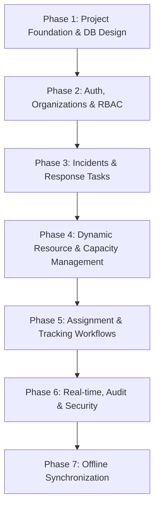
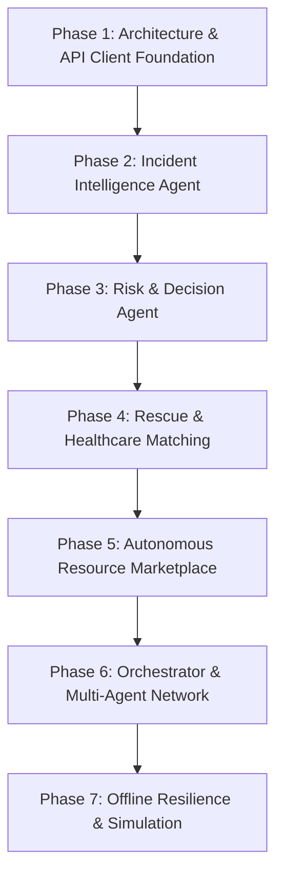

# Development Phases & Phase Completion Gates

## 1. Overview & Non-Negotiable Gate Policy

Development in RESQ is strictly phase-gated. A phase cannot be marked `COMPLETE` until all its listed deliverables exist, all acceptance criteria are met, and corresponding automated tests pass.

---

## 2. Backend & Database (Developer 1) Phases

### Backend Phase 1 — Project Foundation and Database Design
- **Key Tasks:** FastAPI app setup, PostgreSQL 16 + PostGIS configuration, SQLAlchemy models, Alembic migrations, Pydantic schemas, synthetic seed data, health-check endpoint.
- **Phase Completion Gate:** The application starts, the database connects, migrations execute cleanly, and initial tests pass.

### Backend Phase 2 — Authentication, Organizations and Permissions
- **Key Tasks:** Secure JWT authentication, organization models (Rescue, Hospital, Ambulance, Pharmacy, Blood Bank, Supplier, Admin), RBAC enforcement, organization data isolation, unauthenticated citizen submission bypass.
- **Phase Completion Gate:** Authentication, organization isolation, and authorization tests pass.

### Backend Phase 3 — Incident and Response-Task Management
- **Key Tasks:** Citizen SOS reporting, coordinate validation, unique incident numbers, multi-task generation linked to one incident, secure tracking tokens, status transition history.
- **Phase Completion Gate:** One incident can create and maintain multiple linked response tasks via API.

### Backend Phase 4 — Dynamic Resource and Capacity Management
- **Key Tasks:** Deterministic hospital bed formulas ($Available = Total - Occupied - Reserved - OutOfService$), ambulance fleet status, rescue equipment, blood/pharma inventory, atomic time-bounded reservations, expiry worker.
- **Phase Completion Gate:** Capacity updates deterministically under reservations, admissions, releases, and concurrent access.

### Backend Phase 5 — Assignment, Tracking and Operational Workflows
- **Key Tasks:** Task assignment, responder accept/reject, transportation status updates, hospital admission confirmation, citizen arrival confirmation, dual-acknowledgment discrepancy handling.
- **Phase Completion Gate:** A synthetic incident transitions from submission to assignment, arrival, and closure through APIs.

### Backend Phase 6 — Real-time, Audit and Security
- **Key Tasks:** WebSockets for live incident/task streams, Redis Pub/Sub, immutable audit log ledger, rate limiting, request validation, integration tests.
- **Phase Completion Gate:** Authorized clients receive live WebSocket events, and all critical operations are recorded in audit logs.

### Backend Phase 7 — Offline Synchronization
- **Key Tasks:** Queued event ingestion (`POST /api/v1/sync/events`), UUIDv4 idempotency, stale data rejection, conflict resolution preserving capacity invariants, synchronization tests.
- **Phase Completion Gate:** Offline events synchronize safely without duplicate processing or unsafe capacity violations.

---

## 3. Integration & AI Agents (Developer 2) Phases

### Integration Phase 1 — Architecture and API Integration Foundation
- **Key Tasks:** Agent project environment, LangGraph setup, Gemini API configuration, typed Pydantic I/O schemas, typed HTTP client for backend APIs, mock API client for unbuilt endpoints.
- **Phase Completion Gate:** Agent runtime initializes and successfully executes calls against mock backend services.

### Integration Phase 2 — Incident Intelligence Agent
- **Key Tasks:** Natural language entity extraction from citizen reports, hazard categorization, victim counts, trapped/injured detection, location entity normalization, duplicate detection queries.
- **Phase Completion Gate:** Synthetic citizen reports are accurately interpreted into validated structured incident payloads.

### Integration Phase 3 — Risk & Decision Agent
- **Key Tasks:** Triage priority scoring (CRITICAL/HIGH/MEDIUM/LOW), deterministic clinical triage rules, multi-pathway recommendation engine, task proposal generation.
- **Phase Completion Gate:** A synthetic incident produces appropriate structured task recommendations with clear rationale.

### Integration Phase 4 — Rescue and Healthcare Matching
- **Key Tasks:** Rescue Matching Agent (spatial + capability ranking), Hospital & Medical Matching Agent (capacity verification + ambulance sync), Route & Mobility Agent (hazard polygon checking).
- **Phase Completion Gate:** Agents recommend optimal resources based on backend capacity and geographic constraints.

### Integration Phase 5 — Autonomous Resource Marketplace
- **Key Tasks:** Resource Marketplace Agent, supply discovery, ethical matching algorithms (need/urgency prior to distance), atomic reservation requests, courier task coordination.
- **Phase Completion Gate:** A synthetic resource request is matched, reserved, dispatched, and confirmed through API contracts.

### Integration Phase 6 — Orchestrator and Complete Agent Integration
- **Key Tasks:** LangGraph Orchestrator connecting all 9 agents, state handoffs, timeout recovery, human-approval checkpoints, Verification & Audit Agent integration.
- **Phase Completion Gate:** A raw citizen report triggers the multi-agent graph and completes all backend operations without manual intervention.

### Integration Phase 7 — Offline Resilience and Final Testing
- **Key Tasks:** Continuity & Offline Agent, network interruption handling, stale capacity detection, conflict replay handling, execution of full Kerala Flood Simulation.
- **Phase Completion Gate:** System successfully survives simulated network cutoffs and completes the end-to-end simulation cleanly.
