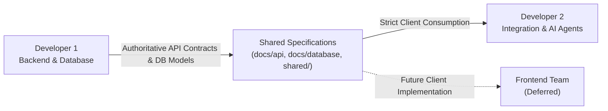

# Team Roles & Ownership Matrix

## 1. Overview

RESQ is developed by two primary engineering disciplines, with user-facing frontend development intentionally deferred to a subsequent milestone.

---

## 2. Developer 1: Backend & Database

- **Primary Working Directory:** `backend/`, `docs/database/`, `docs/api/`, `shared/`
- **Core Responsibilities:**
  1. Relational schema design, PostGIS spatial queries, and Alembic database migrations.
  2. FastAPI routing, dependency injection, and deterministic business logic services.
  3. Strict organization multi-tenancy, authentication (JWT), and role-based permissions (RBAC).
  4. Deterministic resource capacity calculation engine (strictly avoiding LLM hallucinations).
  5. Atomic resource reservation engine with automatic time-based expiry.
  6. Operational status state-machine transitions and arrival discrepancy reconciliation.
  7. Real-time WebSocket broadcasting and Redis Pub/Sub integration.
  8. Offline event ingestion, duplicate filtering, and conflict-resolution APIs.
- **Contract Ownership:** Developer 1 owns and publishes the authoritative API schema and endpoints in `docs/api/api-contracts.md`.

---

## 3. Developer 2: Integration & AI Agents

- **Primary Working Directory:** `agents/`, `simulation/`
- **Core Responsibilities:**
  1. LangGraph multi-agent state graph orchestration and node transitions.
  2. Integration of Google Gemini API for unstructured text/voice entity extraction.
  3. Risk assessment and multi-pathway task generation rules (SALT/START triage).
  4. Spatial ranking heuristics for rescue teams and hospital bed discovery.
  5. Autonomous Resource Marketplace matching and fair allocation logic.
  6. Offline resilience, degraded operation handling, and event playback coordination.
  7. Kerala Flood end-to-end multi-agent scenario simulation execution.
- **Contract Boundary:** Developer 2 consumes backend contracts using typed HTTP clients and must never directly access or modify the database.

---

## 4. Frontend Team (Deferred)

- **Primary Working Directory:** `frontend/` (PWA portals: Citizen, Rescue, Healthcare, Control Room, Admin).
- **Status:** **Intentionally Postponed.**
- **Policy:** Neither Developer 1 nor Developer 2 should implement user interfaces, UI dashboards, or frontend frameworks during current phases. The frontend will be introduced once core backend APIs and agent intelligence workflows have passed all automated validation criteria.
